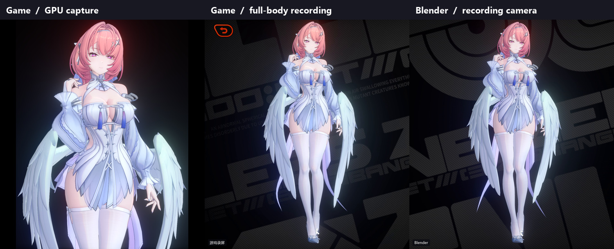

# ZZZ Toon · Outfit preview rendering for Blender

[简体中文](README.zh-CN.md) · [Download v0.52.1](https://github.com/Gartchen/Blender_ZZZToonShading/releases/download/v0.52.1/zzz_toon-0.52.1.zip) · [Installation and first preview](docs/quickstart.en.md) · [Generic mode and its limits](docs/generic-scope.en.md) · [Asset checklist by outfit](docs/asset-checklist.en.md)

ZZZ Toon is a character-rendering add-on for **Blender EEVEE**. It reconstructs the *Zenless Zone Zero* **outfit preview** from a user-supplied model, textures and idle animation. The result is an editable Blender scene with a character, scrolling background and continuous full-body to close-up framing. The outfit-selection UI is omitted so the scene can be used for material inspection, comparison with the game and rendered character showcases.

**For a first preview, choose the tested outfit for Remielle, Velina or Vivian.** The quick start covers installation, file selection, playback and export. [Build your first scene](docs/quickstart.en.md)

**v0.52.1** applies bone corrections when building a preview with a matching idle. They improve Remielle’s sleeves and wings, Velina’s bow ribbons, and Vivian’s sleeves, back hair and parasol attachments. Rebuild the preview with your original files after updating to see the changes.

## Two workflows

| Mode | Intended use | Inputs and result |
| --- | --- | --- |
| **Dedicated outfit presets** | Reproduce the tested outfits for Remielle, Velina and Vivian. | Choose the character and supply its matching model, textures and idle. The preset loads the outfit’s material bindings, lighting, camera range and look settings into a playable project. |
| **Generic** | Inspect material assignments and preview shading shared by four reference outfits. Miyabi’s default outfit was tested through this mode. | An FBX alone is enough to list and locate every material slot. Textures and an idle allow a scene build. A native material table and a matching wardrobe capture can establish further bindings, draws and extra effects. |

Both workflows share rendering code. The body shadow and reflection calculations can be reused across outfits. Bindings such as the UVs on the back of a parasol, eye lookup indices and draws for a separate accessory must be established for the relevant outfit. [Why a complete outfit preview needs a preset](docs/generic-scope.en.md)

## From source assets to a Blender scene

| Stage | Implementation |
| --- | --- |
| Geometry and animation | Import the rigged, skinned FBX and bind the matching idle to the skeleton. Preserving mesh and material assignments, triangles, UVs and vertex colors helps map the game’s inputs to the right surfaces. |
| Character shading | Reconstruct nodes for supported game shader operations and material tables. Body and hair use base color, normal and packed material maps. Material IDs select shadow and reflection settings. The face lightmap, eye lookup and brow/fringe coverage have distinct roles. |
| Outlines and compositing | Where the implementation and inputs support them, apply outlines, rim lighting, transparency, character grading and Bloom. Composite the character and glow over a scrolling page, using either a generated background or a supplied tileable image. |
| Playback and output | Build a separate `.blend` with editable materials, camera and animation. Fullscreen controls turn the character, adjust framing height and zoom. Blender can render stills or an animation from the same scene. |

**Three sources inform the reconstruction.** Original materials and meshes supply authored colors, texture references and surface data. Captures matched by geometry and UVs establish bindings and runtime constants for a specific draw. Recordings are used to judge the result at different distances and in motion. Some dedicated appearance settings are calibrated per outfit, and missing inputs can require approximations. For example, missing back-face UVs can change the pattern on a parasol even when its base color texture is correct.

## Assets, compatibility and validation

- **Environment.** v0.52.1 was tested on Windows with Blender 5.3.0. The installer contains the add-on, presets and resources for the generated background. Users supply character models, game textures, animation and any optional frame captures.
- **Formats.** Use an FBX model and a matching Unity text `.anim` or supported AnimationClip JSON. Certain surfaces can take a matching multi-UV model, native material table or auxiliary file. Three [starter scenes](examples) have their character preset selected.
- **Test coverage.** The four test FBXs contain 75 source material slots. Each slot was located before generation and after reopening the built project. Shading was assessed separately at capture-aligned cameras, with attention to face shadows, eyes, translucent fringe and body materials. The slot counts describe inspector coverage.

## Documentation

| Reader goal | Guide |
| --- | --- |
| Install the add-on and play an outfit idle | [First preview, step by step](docs/quickstart.en.md) |
| Check your files against the tested set for each outfit | [Complete asset checklist for all three outfits](docs/asset-checklist.en.md) |
| Select the right assets and understand an inspector message | [File and material inspection guide](docs/inputs.en.md) |
| Understand the D/N/M/A maps, face shadows and metal highlights | [Illustrated shading guide](docs/shading.en.md) |
| Decide what Generic can establish and what a new outfit needs | [Generic scope and preset design](docs/generic-scope.en.md) |

The rendering implementation lives in [zzz_toon](zzz_toon). Outfit parameters and input definitions are in [wardrobe_data](zzz_toon/wardrobe_data).

## Outfit gallery

The close-ups compare the game and Blender. The wide shots include a frame from a game video so you can see the whole outfit. Each GIF shows the character turning in Blender. These examples use the full set of reference files for each outfit.

### Remielle

### Velina

### Vivian

This is an independent Blender project. Game artwork and reference imagery belong to the creators of *Zenless Zone Zero*. The project draws on the community work in [HoyoToon](https://github.com/Hoyotoon/HoyoToon).
