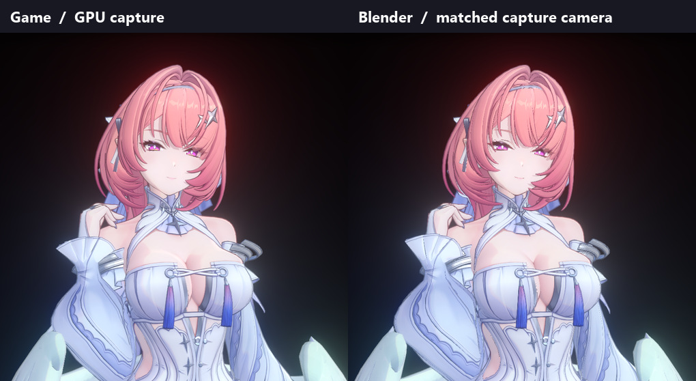
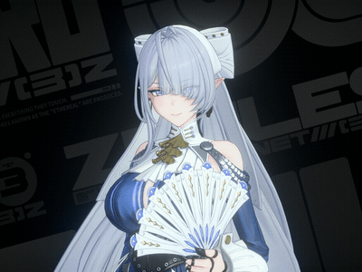
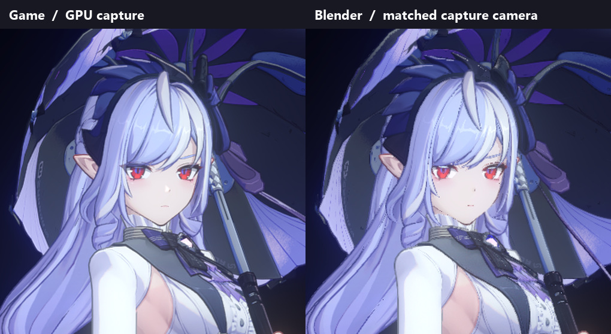
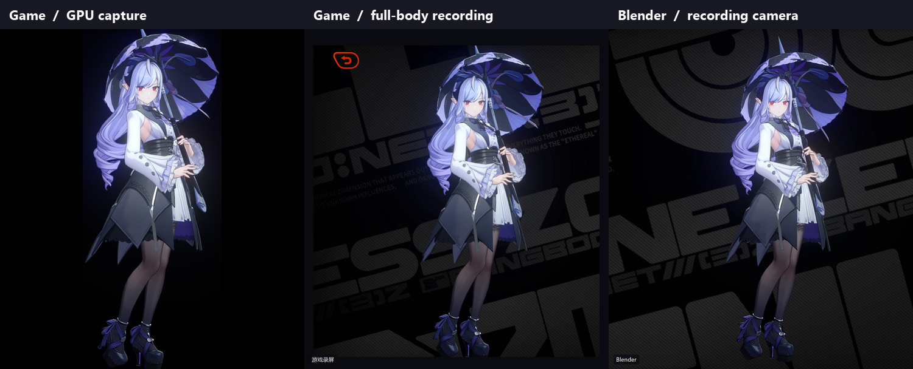
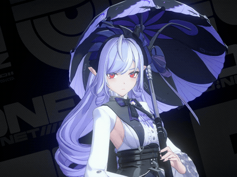

# ZZZ Toon for Blender

[简体中文](README.zh-CN.md) · [Download v0.52.0](https://github.com/Gartchen/Blender_ZZZToonShading/releases/download/v0.52.0/zzz_toon-0.52.0.zip) · [Input and inspector guide](docs/inputs.en.md) · [Shader walkthrough](docs/shading.en.md)

Build an editable *Zenless Zone Zero* wardrobe preview in Blender EEVEE from your own model, textures and idle animation. The preview plays over a scrolling background. You can rotate the character and move continuously between a full-body view and a close-up.

## What v0.52.0 does

| Choose in the sidebar | Use it for |
| --- | --- |
| **Remielle, Velina or Vivian** | Recreate the tested outfit with its dedicated material, lighting, camera and Bloom settings. The gallery below shows these three presets. |
| **Generic** | Inspect a model using the shading shared by those three outfits and Miyabi’s default outfit. Six material groups are covered: face, eyes, brows/lashes, hair, Body 1 and Body 2. Choose this option for Miyabi. |

Generic lists **every mesh and material-slot assignment** in the FBX, including hidden accessories. Click a row to inspect its inputs. Click its magnifier to highlight the faces. A matching wardrobe capture can distinguish an enabled effect from a neutral input in a specific draw. All 75 slots across the four test models were located both before and after scene generation. [Reading the results](docs/inputs.en.md#generic-material-slot-inspector)

## Install

1. Download [zzz_toon-0.52.0.zip](https://github.com/Gartchen/Blender_ZZZToonShading/releases/download/v0.52.0/zzz_toon-0.52.0.zip). The installable add-on is this ZIP asset on the release page. It was tested on Windows with Blender 5.3.0.
2. In Blender, open **Edit → Preferences → Add-ons → menu → Install from Disk**. Select the ZIP and enable **ZZZ Toon**. If you are updating an enabled installation, restart Blender to load the new code.
3. Move the pointer into the **3D Viewport**, press **N**, open **ZZZ Toon**, and choose **English** or **中文**.

## Preview a supported outfit

1. Choose **Remielle**, **Velina** or **Vivian**. You can also start with the matching [starter scene](examples), which has the preset selected and its input fields empty.
2. Choose the skinned **FBX** and its matching idle animation (Unity text `.anim` or a supported AnimationClip JSON). Preserve the mesh slots, bone paths, vertex colors and UVs when exporting.
3. Fill the labeled image slots, including the face lightmap, eye lookup and MatCaps where requested. Renamed files can be selected manually. Supply a seamless background image if desired, or use the generated scrolling background.
4. Choose a writable output folder and click **Build and open outfit preview**. Blender generates a separate, editable project. Click **Enter fullscreen preview** to play the idle. **Render → Render Animation** exports the timeline.

| Fullscreen control | Action |
| --- | --- |
| Hold the left mouse button and drag horizontally | Rotate the character |
| Hold it and drag vertically | Move the framing up or down |
| Scroll up / down | Zoom in / out |
| Esc | Restore the previous layout |

## Inspect a model with Generic

1. Choose **Generic**, select the main FBX and click **Read FBX slots**. The model alone is sufficient to locate a slot in its rest pose.
2. Open **All model slots** and select a row. Use the magnifier to center and highlight its faces. **Clear highlight** returns to the previous view.
3. To build the preview, add the matching idle and textures. Supply the original material JSON to read local colors and bindings. An optional matching **FrameAnalysis folder** supplies supported draw evidence. Use **Check input files** after changing a path.
4. In the generated project, select a row to see the files feeding its shader, fields read from its table, inputs outside the shared shading, and the matching draw numbers. An unverified draw leaves an effect’s activity unknown. [Input requirements and examples](docs/inputs.en.md)

## Preset gallery

The close-ups compare the game capture and the preset render at the matching camera. The wide panels include the game recording to show the full outfit. The GIFs show the Blender close-up turn. These examples use the full local reference inputs.

### Remielle

### Velina

### Vivian

Game artwork and reference imagery are credited to the creators of *Zenless Zone Zero*. This is an independent Blender project. [Shader techniques and input sources](docs/shading.en.md) · [Community shader reference](https://github.com/Hoyotoon/HoyoToon)
