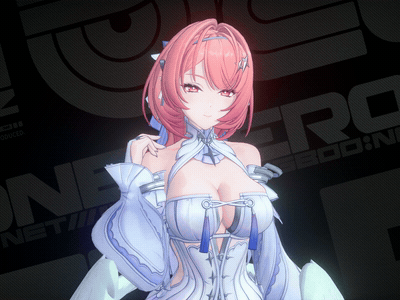
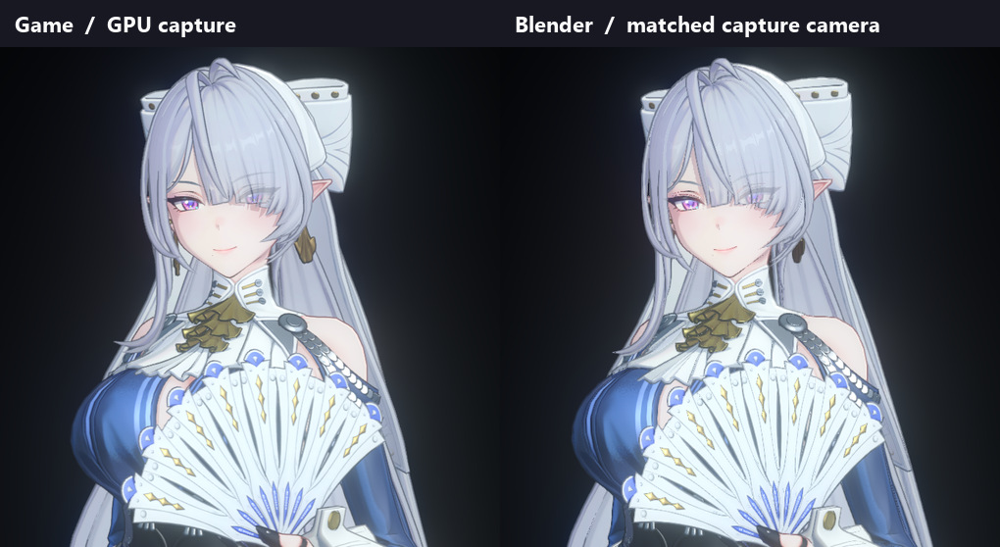

# ZZZ Toon · View Zenless Zone Zero outfits in Blender

[简体中文](README.zh-CN.md) · [Download v0.52.0](https://github.com/Gartchen/Blender_ZZZToonShading/releases/download/v0.52.0/zzz_toon-0.52.0.zip)

Watch a character play their idle animation against a scrolling background, like the outfit screen in the game. Drag to turn the character around, or zoom in to see their face.

## Where should I start?

| I want to… | Choose | Files I need |
| --- | --- | --- |
| View an outfit for Remielle, Velina or Vivian | Choose the character's name. The colors, lights and camera are set up for you. | The model, textures and idle animation for that outfit |
| See which part of a model uses an image | Choose **Generic**. Use this for Miyabi too. | Just the model to get started |

You supply the character files for both the add-on and the starter scenes. A **texture** is an image used on a model. An **idle animation** is the short move a character plays while standing still, like breathing or swaying.

## Install the add-on

1. Download **zzz_toon-0.52.0.zip** and leave it zipped. We tested it on Windows with Blender 5.3.0. [Get the ZIP](https://github.com/Gartchen/Blender_ZZZToonShading/releases/download/v0.52.0/zzz_toon-0.52.0.zip)
2. Open Blender and go to **Edit → Preferences → Add-ons**. Open the menu at the top right, choose **Install from Disk** and pick the ZIP.
3. Find **ZZZ Toon** and make sure it is enabled. If you already had it installed, restart Blender after the update.
4. Move your mouse over the **3D Viewport**, where you see the model. Press **N** to open the sidebar. Select **ZZZ Toon → English**.

## View your first outfit

Try **Remielle** below. For Velina or Vivian, follow the same steps with that character’s files.

1. Set **Character** to **Remielle**. If you open her [starter scene](examples), her name is already selected.
2. Under **FBX**, pick her `.fbx` model. Under **Idle**, pick the idle move that belongs to it.
3. Open **Face and eyes**, **Hair**, **Outfit**, **Weapon and wings** and **MatCap** as shown for the outfit. Fill the main image boxes with the files named there. For example, `Remielle_Face_D.png` gives her face its base color. You can leave the background empty. The add-on makes a scrolling one.
4. Set **Output** to a folder where you can save your work. Click **Build and open outfit preview**. When it finishes, Blender opens a new `.blend` project.
5. Click **Enter fullscreen preview**. Hold the left mouse button and drag sideways to turn the character. Drag up or down to change the height of the view. Scroll up to zoom in or down to zoom out. Press **Esc** to return.

To save a video, choose **Render → Render Animation** in the new project. If you get stuck choosing a file, use the table in the guide. [Which file goes where?](docs/inputs.en.md)

## Find the part of a model that uses a material

A **material slot** tells Blender which faces of the model share a look. A parasol can have one slot for the canopy and another for the handle.

Choose **Generic**, pick the main FBX and click **Read FBX slots**. Under **All model slots**, click the magnifier on a row. The matching faces light up. Click **Clear highlight** to return to your view.

Generic uses shading shared by four tested outfits. It covers the face, eyes, brows and lashes, hair, and two body groups. The list also shows extra parts and effects. The guide uses Vivian and Remielle to explain messages like “Missing” and “Inactive in draw”. [How to read the results](docs/inputs.en.md#how-to-read-the-results)

## Outfit gallery

The close-ups compare the game and Blender. The wide shots include a frame from a game video so you can see the whole outfit. Each GIF shows the character turning in Blender. These examples use the full set of reference files for each outfit.

### Remielle

### Velina

### Vivian

Curious about the shadow on a white sleeve or the shine on metal? Start with one piece of cloth. [How the shading works](docs/shading.en.md)

This is an independent Blender project. Game art and reference images belong to the creators of *Zenless Zone Zero*. The project draws on the community work in [HoyoToon](https://github.com/Hoyotoon/HoyoToon).
