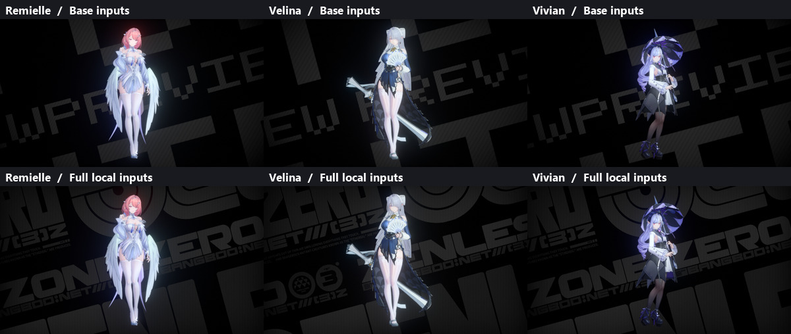
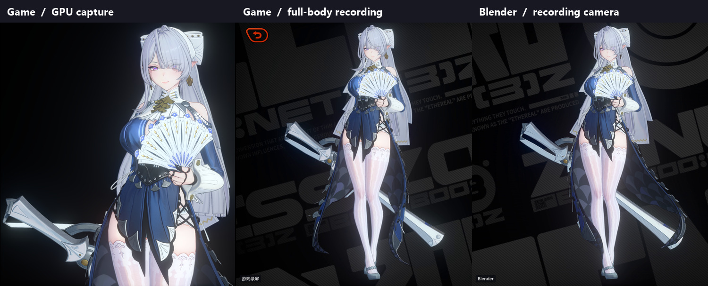

# ZZZ Toon for Blender

[简体中文](README.zh-CN.md) · [Download the add-on](https://github.com/Gartchen/ZZZ-Toon-Shading/releases/latest) · [Shader walkthrough](docs/shading.en.md)

Build an editable *Zenless Zone Zero* outfit-preview scene in Blender EEVEE. Choose Remielle, Velina or Vivian, assign your local model, textures and idle clip, then open a fullscreen preview. The character stays centered as you move between full body and close-up. A scrolling background fills the frame.

## Supported outfits

The release provides presets and render validation for **Remielle, Velina and Vivian in the tested outfits only**. A matching FBX, the character textures and an idle clip are enough to build a preview. Supporting another character or costume requires implementing and validating its own adapter. A shared body shader can still use different material slots, draw order, head and rig frames, vertex-color flags, UV conventions, fringe transmission or weapon branches. A new preset must map those inputs and check them against that outfit's preview draws.

## Install and build your first scene

1. Use **Blender 5.3**. The release was tested with **5.3.0 on Windows**. Download **zzz_toon-0.47.6.zip** from [Releases](https://github.com/Gartchen/ZZZ-Toon-Shading/releases/latest).
2. In **Edit → Preferences → Add-ons**, open the menu at the top right, choose **Install from Disk**, select that ZIP and enable **ZZZ Toon**.
3. Open a new scene or one of the [starter files](examples). In the **3D Viewport**, press **N**, select the **ZZZ Toon** tab, choose **English** or **中文**, then select the character.
4. Assign the skinned **FBX** and matching **Idle**. Expand the face, hair, outfit, weapon and MatCap groups and fill the labeled image slots. The label identifies the expected image even when your file has been renamed. The groups vary by outfit.
5. Leave **Scrolling background** empty for original procedural lettering and a vignette moving at the preset’s three layer speeds. Alternatively, choose a seamless image or replace individual page layers. Choose a writable **Output** folder.
6. Click **Build and open outfit preview**. Blender builds a separate project, imports the rig and clip, creates materials and the compositor, then opens the generated `.blend`. In a configured scene click **Enter fullscreen preview**. Use **Render → Render Image** for a still or **Render → Render Animation** for the timeline.

| Control in fullscreen | Result |
| --- | --- |
| Hold left mouse and drag horizontally | Turn the character |
| Hold left mouse and drag vertically | Move the camera framing up or down |
| Scroll up / down | Zoom continuously toward the close-up / full-body limit |
| Esc | Return to the previous layout |

## What to supply

| Input | What the preset expects |
| --- | --- |
| Model | The matching outfit FBX, with its original rig, mesh and material-slot names, vertex colors, skin weights, UV layout and triangle order. An auxiliary FBX can provide extra UV sets for supported outfits. |
| Idle | A baked Unity AnimationClip in text `.anim` format, or the parsed JSON accepted by the [clip reader](zzz_toon/clip_io.py). Bone paths must match the rig. |
| Material images | Fill all visible base texture slots, including the named MatCaps, face lightmap and eye lookup where shown. Remielle and Velina each have 24 base slots. Vivian has 23, including the parasol material set. |
| Page art | One repeating color image or all three layer images for the original layout. The generated scene contains the character and background only. |
| Optional reference inputs | A matching character LUT, authored mip atlases, fine-detail overlay, auxiliary UV and supported per-mesh or face-outline files can be assigned where shown. Some streams use project-specific formats. See the [input reference](docs/shading.en.md#local-reference-inputs). |

**What do base inputs reproduce?** All three presets supply material parameters, body and hair light directions, camera limits and Bloom. The add-on generates mip levels from textures, recovers supported surface inputs from verified FBXs and generates an approximate character grade from a shared numeric model. A supplied local LUT or matching geometry stream takes precedence. The capture gallery uses the full local reference setup. See the [per-outfit input audit and render comparison](docs/inputs.en.md).

The templates [Remielle](examples/Remielle.blend), [Velina](examples/Velina.blend) and [Vivian](examples/Vivian.blend) open with the preset selected and the input fields empty. Press **F12** to render their procedural two-tone material study before supplying a character.

**Fresh public install.** The top row uses each model, its textures, an idle and the generated three-layer page. The bottom row adds the local auxiliary files and original page layers. These are small validation renders. The larger reference plates follow below.

## Gallery

Close-ups use identical crops of the native character render target and a Blender render at its registered camera. Wide plates show the native capture, a full-body game recording frame and the corresponding Blender view. The Remielle and Velina captures end at the thighs. Vivian's capture includes her parasol and feet. Each GIF is the close-up turn from the previous 4K60 Blender film.

### Remielle

### Velina

### Vivian

## Common issues

| Symptom | Check first |
| --- | --- |
| No panel | Enable the add-on, then press N with the pointer inside a 3D Viewport. |
| Model or idle rejected | Check the selected outfit, bone paths and material slots. Re-exporting with merged meshes or reordered vertices can break stream correspondence. |
| Dark accessory, missing parasol detail | Inspect the weapon D/N/M/A group and its MatCap assignment. Try the matching surface streams before changing light strength. |
| Fringe covers an eye, or a face looks washed out | Inspect eye lookup, vertex colors, hair alpha, face auxiliary streams and the character LUT. Compare at the same camera angle. |
| Preview feels slow | The public build renders locally without the pre-recorded idle caches. Timeline playback may drop frames. Use Render Animation for full-quality output. |

Game artwork and reference imagery are credited to the creators of *Zenless Zone Zero*. This is an independent Blender project. The [walkthrough](docs/shading.en.md) distinguishes capture measurements, Blender approximations and wardrobe-specific appearance adjustments.

Community shader reference used during development: [HoyoToon](https://github.com/Hoyotoon/HoyoToon).
