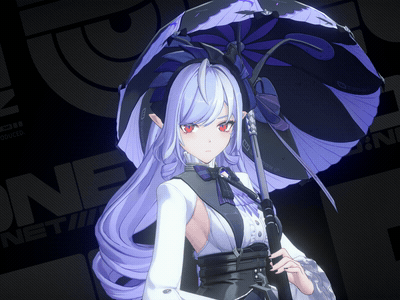

# ZZZ Toon · 绝区零服装预览渲染插件

[English](README.md) · [下载 v0.52.0](https://github.com/Gartchen/Blender_ZZZToonShading/releases/download/v0.52.0/zzz_toon-0.52.0.zip) · [安装与第一次预览](docs/quickstart.zh-CN.md) · [通用入口的限制](docs/generic-scope.zh-CN.md)

ZZZ Toon 是一个面向 **Blender EEVEE** 的角色渲染插件。项目以《绝区零》的**服装预览页**为参考，从用户提供的模型、贴图和待机动画构建可编辑的 Blender 场景。输出保留角色、滚动背景，以及从全身到近景的连续取景；画面中省去服装选择 UI，适合观察材质、对照游戏画面或导出角色展示片段。

**第一次使用，建议先用 Remielle、Velina 或 Vivian 的已验证服装生成一个预览。** 安装、填文件、播放和导出都在这份白话教程里。[跟着做一次](docs/quickstart.zh-CN.md)

## 两种工作方式

| 入口 | 适用目标 | 输入与结果 |
| --- | --- | --- |
| **专用服装预设** | 复现 Remielle、Velina、Vivian 各自已验证的服装外观。 | 选择角色，填入匹配模型、贴图和待机。插件载入该服装的材质绑定、灯光、镜头范围与画面设置，生成可播放的工程。 |
| **通用 / Generic** | 检查模型的材质结构，预览四套样本共有的着色效果。星见雅默认服装通过此入口验证。 | 单个 FBX 即可列出并定位全部材质槽。加入贴图和待机可构建预览；原始材质表及匹配的服装预览抓帧可进一步确认输入、绘制和额外效果。 |

两种入口共享渲染实现。身体主材质的阴影和反射计算可以复用，而伞面正反面的 UV、眼睛查色索引、独立配件的绘制方式等，需要对应服装的资源与验证。通用入口和专用预设如何分工，有单独说明。[为什么完整预览按服装配置](docs/generic-scope.zh-CN.md)

## 从原始资源到 Blender 场景

| 环节 | 插件的处理 |
| --- | --- |
| 模型与动作 | 导入带骨架和蒙皮的 FBX，将匹配的待机动画绑定到骨骼。保留原始网格、材质槽、三角面、UV 和顶点色，有助于把游戏中的输入对应到正确的表面。 |
| 角色着色 | 依据支持的游戏着色程序和材质表重建节点。身体和头发分别读取底色、法线及材质遮罩；材质 ID 选择阴影和反射参数。脸部光照图、眼睛查色表、眉睫与刘海的遮挡走各自的处理路径。 |
| 轮廓与合成 | 在有对应实现和输入时计算描边、边缘光、透明覆盖、角色调色和 Bloom。再将角色与光晕合成到滚动背景上。可选择程序生成的背景，或提供自己的可平铺背景图。 |
| 播放与输出 | 生成独立的 `.blend` 工程，可继续编辑材质、相机和动画。全屏预览支持拖动转身、调整取景高度和滚轮推拉；Blender 的渲染功能可输出静帧或动画。 |

**还原依据分三层。** 原始材质和网格提供作者设置的颜色、贴图引用及表面数据；与网格及 UV 匹配的抓帧提供某次实际绘制的绑定和运行时常量；视频用于检验近景、远景与运动中的观感。部分专用外观参数经过角色级校准，缺少特定输入时也可能使用近似值。例如，缺少背面 UV 会影响伞面图案，即使底色图本身正确。

## 资源、兼容性与验证

- **运行环境。** v0.52.0 已在 Windows、Blender 5.3.0 上验证。安装包提供插件、预设和生成背景所需的资源。角色模型、游戏贴图、动画及可选的抓帧文件由用户自行准备。
- **输入格式。** 主模型使用 FBX，待机使用匹配的 Unity 文本 `.anim` 或受支持的 AnimationClip JSON。针对某些表面，可以补充同源多 UV 模型、原始材质表或辅助文件。仓库提供三个已选好角色的[起始工程](examples)。
- **验证范围。** 四套测试模型共 75 个原始材质槽，逐槽测试了生成前和工程保存重开后的定位。着色效果另以匹配机位的抓帧比较，重点检查脸部阴影、眼睛、透明刘海及身体材质。跨角色统计衡量的是槽位检查覆盖范围。

## 文档导航

| 想了解什么 | 从哪里开始 |
| --- | --- |
| 安装插件，让第一个角色动起来 | [白话入门](docs/quickstart.zh-CN.md) |
| 模型、动作和图片分别填哪一格，检查提示怎么读 | [文件与材质检查指南](docs/inputs.zh-CN.md) |
| D/N/M/A、脸部阴影和金属反射怎样形成画面 | [着色图文教程](docs/shading.zh-CN.md) |
| 通用模式能识别什么，新服装为何需要专用配置 | [通用范围与预设设计](docs/generic-scope.zh-CN.md) |

渲染实现位于 [zzz_toon](zzz_toon)，服装参数与输入定义位于 [wardrobe_data](zzz_toon/wardrobe_data)。

## 三套服装的效果

近景图对比游戏和 Blender。全身图还放了一帧游戏录屏，方便看整套衣服。动图是 Blender 里的转身效果。这里用到了各角色完整的参考文件。

### Remielle

### Velina

### Vivian

本项目由独立开发者制作。《绝区零》的游戏美术和参考画面归原作者所有。开发时参考了社区项目 [HoyoToon](https://github.com/Hoyotoon/HoyoToon)。
