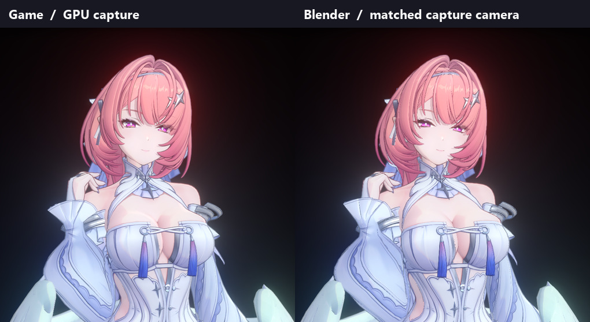
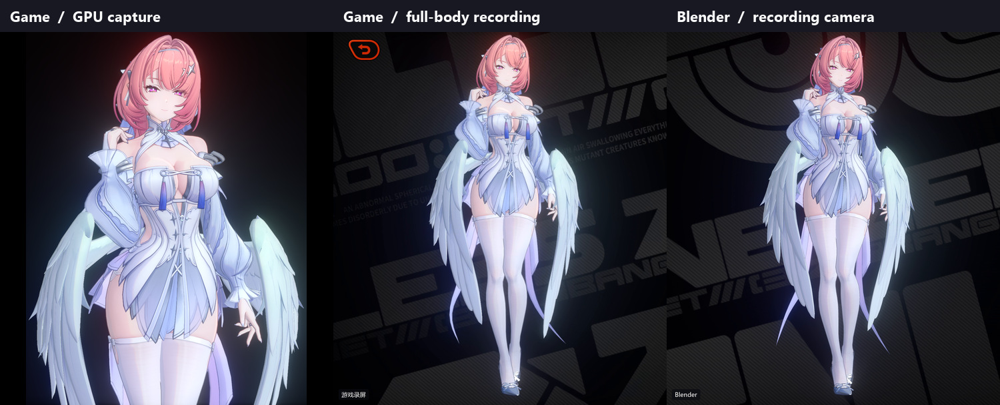
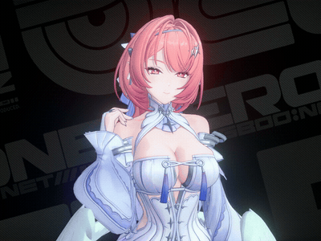
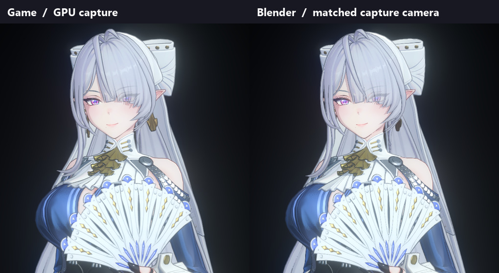
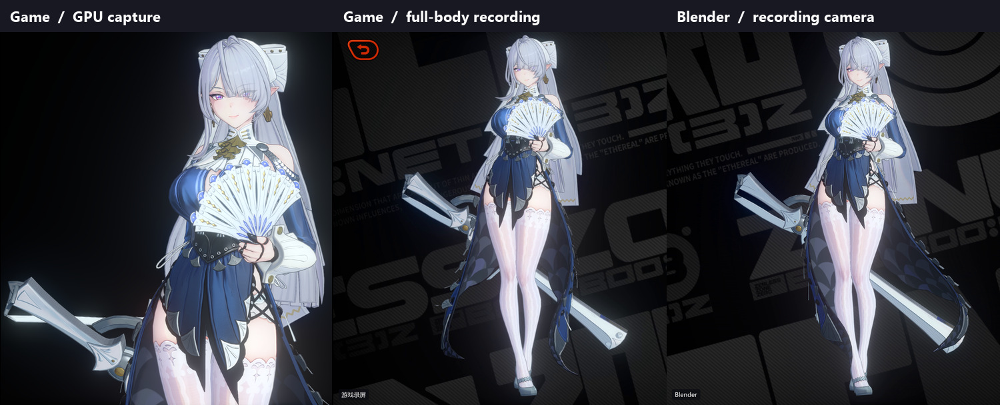
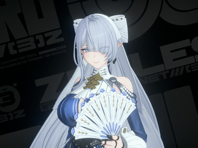
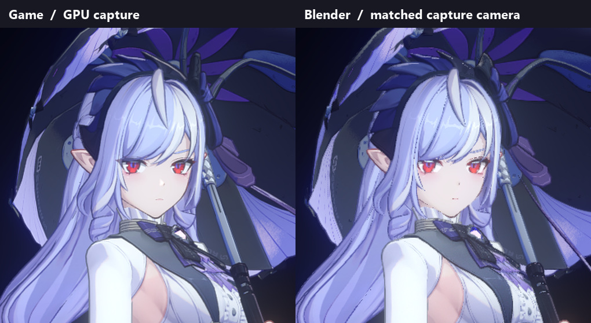
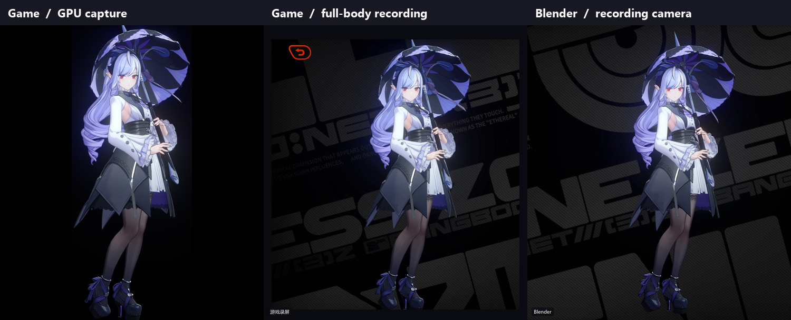

# ZZZ Toon · 绝区零服装预览 Blender 插件

[English](README.md) · [下载 v0.52.0](https://github.com/Gartchen/Blender_ZZZToonShading/releases/download/v0.52.0/zzz_toon-0.52.0.zip) · [输入与材质槽检查指南](docs/inputs.zh-CN.md) · [着色复现教程](docs/shading.zh-CN.md)

用自己的模型、贴图和待机动画，在 Blender EEVEE 里生成可编辑的服装预览场景。播放时背景循环滚动，可以旋转角色，也可以在全身和近景之间连续推拉镜头。

## v0.52.0 提供什么

| 侧栏选项 | 适合什么情况 |
| --- | --- |
| **Remielle、Velina、Vivian** | 观看这三套已验证服装。选择角色后会应用对应的材质、光照、镜头和 Bloom 参数。下方画廊展示这三份专用预设。 |
| **通用 / Generic** | 用上述三套服装与星见雅默认服装共有的着色流程检查模型，范围涵盖脸、眼睛、眉睫、头发、身体一和身体二。星见雅选这个入口。 |

通用入口会列出 FBX 中**每个网格的全部材质槽**，包括预览中隐藏的配件。选行可读输入，点击放大镜可高亮对应的面。给出匹配的服装预览抓帧后，还能区分某次绘制启用的效果与已验证为中性的输入。四套测试模型共 75 个槽，均通过生成前和生成后的定位测试。[如何阅读检查结果](docs/inputs.zh-CN.md#通用材质槽检查器)

## 安装

1. 下载 [zzz_toon-0.52.0.zip](https://github.com/Gartchen/Blender_ZZZToonShading/releases/download/v0.52.0/zzz_toon-0.52.0.zip)。这是发布页上用于安装的插件包，已在 Windows 和 Blender 5.3.0 测试。
2. 在 Blender 打开 **编辑 → 偏好设置 → 插件 → 右上角菜单 → 从磁盘安装**，选择该 ZIP，启用 **ZZZ Toon**。如果正在使用已启用的旧安装，更新后重启 Blender 以载入新代码。
3. 将鼠标移到 **3D 视图**，按 **N** 打开侧栏，选择 **ZZZ Toon** 标签，切换到 **中文** 或 **English**。

## 用专用预设观看服装

1. 选择 **Remielle**、**Velina** 或 **Vivian**。也可以打开对应的[起始工程](examples)，里面已选好角色，资产栏留空。
2. 填入带蒙皮的 **FBX** 和匹配的待机动画，支持 Unity 文本 `.anim` 或受支持的 AnimationClip JSON。导出时保留网格材质槽、骨骼路径、顶点色和 UV。
3. 按标签填写贴图，包括该预设需要的脸部光照图、眼睛查色表及 MatCap。文件改过名也可手选。可选一张无缝背景图，留空则使用生成的滚动背景。
4. 选择可写的工程目录，点击 **配置并打开服装预览**。Blender 会生成独立、可编辑的工程。点击 **进入全屏预览** 播放待机。需要导出时选择 **渲染 → 渲染动画**。

| 全屏操作 | 效果 |
| --- | --- |
| 按住鼠标左键左右拖动 | 旋转角色 |
| 按住左键上下拖动 | 上下移动取景位置 |
| 滚轮向上 / 向下 | 拉近 / 拉远 |
| Esc | 返回原布局 |

## 用通用入口检查模型

1. 选择 **通用 / Generic**，填入主 FBX，点击 **读取模型槽位**。这时只需要模型，就可以在静止姿态下定位部件。
2. 在 **模型全部材质槽** 中选中一行，点击放大镜居中并高亮对应面。点 **清除高亮** 恢复之前的视图。
3. 要生成预览，再填入对应的待机和贴图。原始材质 JSON 提供配色与贴图绑定。可选填匹配的 **角色抓帧文件夹** 以读取支持的绘制证据。修改路径后点 **检查输入文件**。
4. 打开生成工程，选择一行可查看着色用到的贴图、读取过的原表字段、交集外输入，以及匹配的绘制编号。没有已核实的绘制时，该效果是否生效仍待确认。[输入要求和判读示例](docs/inputs.zh-CN.md)

## 专用预设画廊

近景在匹配机位对照游戏抓帧与预设渲染。全身图另列游戏录屏以展示完整服装，GIF 展示 Blender 中的近景转身。示例使用完整的本地参考输入。

### Remielle

### Velina

### Vivian

游戏美术与参考画面归《绝区零》创作者所有。本项目由独立开发者制作。[着色原理与输入来源](docs/shading.zh-CN.md) · [社区着色器参考](https://github.com/Hoyotoon/HoyoToon)
