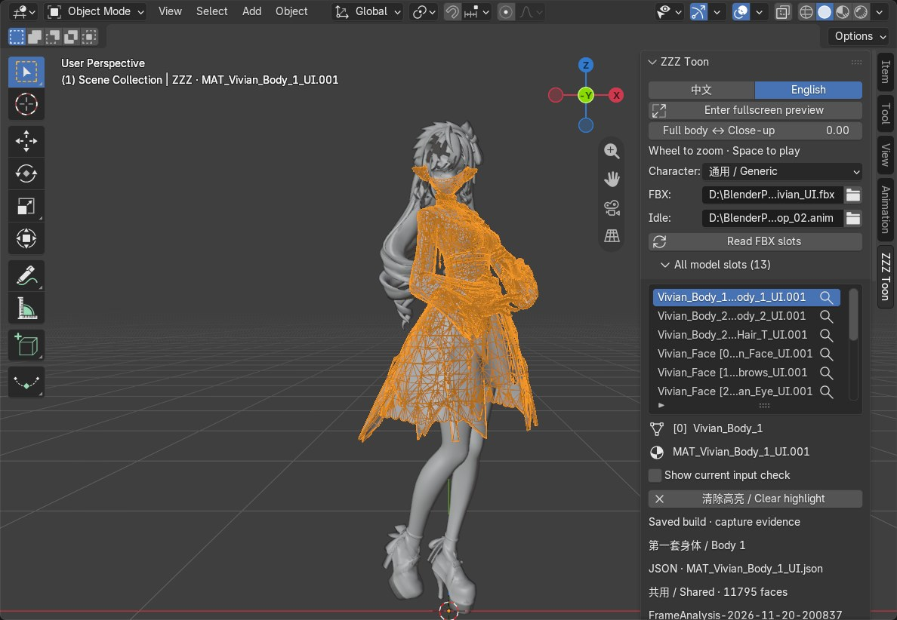

# Which file goes where?

[简体中文](inputs.zh-CN.md) · [Project overview](../README.md) · [Set up your first preview](quickstart.en.md) · [Generic scope](generic-scope.en.md)

**To watch a character move**, get the model, textures and idle animation for the same outfit. **To find a part on the model**, choose **Generic**. You can start with just the model.

Find your character in the checklist. Each row gives the filename and the field where it goes. Start with the base files, then check the extras if you want to match the reference build. [Complete asset checklist](asset-checklist.en.md)

## The files to find first

| File | Where to put it | What it does |
| --- | --- | --- |
| The character’s `.fbx` file | Model FBX | Gives the character its shape and the bones that move it. |
| The matching `.anim` file or an exported AnimationClip JSON | Idle animation | Tells the character how to stand, breathe or sway. The add-on reads Unity’s text form of `.anim`. |
| Images for the face, hair, clothes and other parts | The image box for that part | Supply color, shadow and shine. Pick the file named beside the box. |
| A background image that tiles smoothly | Scrolling background | Fill this to use your own backdrop. Leave it empty to use the built-in scrolling pattern. |

For example, `Vivian_Weapon_D.png` goes in the base color box under **Vivian → Weapon and wings**. Her parasol is her weapon. If you renamed an image, you can still pick it by hand.

## Two extra inputs in Generic

- A **Material JSON** is a list of settings from the game. It says which pictures a piece of cloth uses and what color its shadow should be. Pick that file in the material’s box. The add-on looks for its images in nearby export folders. If two files have the same name, pick the right one yourself. An animation JSON goes in the idle box.
- A **FrameAnalysis folder** is a record of how the game drew one frame. If you have one for the same outfit, pick the folder that contains the draw files. You can build a preview without it, using estimated lighting. An ordinary screenshot or video only shows the finished picture.

## How to read the results

1. Choose **Generic → Read FBX slots → All model slots** and select a row. Click the magnifier to see whether it belongs to a sleeve, some hair or an accessory. Click **Clear highlight** when done.
2. After changing a file, click **Check input files**. In a project you have already built, first turn on **Show current input check**. Build the scene again to see how the change looks.
3. To see what went into the preview, open the row’s details in the generated project. **Located file** means the add-on found an image on disk. **Used** means the add-on used it to shade that part.

| What the panel says | What it means | What to do |
| --- | --- | --- |
| Missing | A file the material needs could not be found. | Pick the file named in the message. |
| Ambiguous | Several files have the same name. | Pick the one for this outfit. |
| Outside | The part or effect goes beyond the shading shared by the four outfits. | Use the magnifier to find it. To see a full outfit for one of the three preset characters, choose the character’s name. |
| Enabled in draw | The game switched the effect on when it drew that part. | Check the game image to see where it shows up. |
| Inactive in draw | The switch was off, or its input had no effect in that draw. | This message alone doesn’t call for another image. |
| No verified draw for this slot | The record doesn’t tell us whether the effect was active here. | If you need to know, check that the capture is for the same outfit. |

**For example**, the game draws a frame in pieces, and each draw has a number. On Remielle’s face, the blush input was zero in draws 44 and 57. Those draws added no blush. On Vivian’s body, draw 37 switched on an extra layer of color. Each result describes that draw in that frame.

## I filled in the images. Why does one part still look wrong?

Some parts use a second set of **UVs**. UVs tell Blender which patch of a flat picture goes on each face of a 3D model. Look inside Vivian’s parasol below. The left view uses the basic files. The middle one adds the matching UV model. The right one uses the full reference files.

| What you see | What to check first |
| --- | --- |
| The pattern inside Vivian’s parasol is wrong | Check the weapon textures, then the matching FBX with extra UVs. |
| The shadow on Velina’s face has the wrong shape | Check the face lightmap, then the extra UVs for her face. |
| The outline of Remielle’s wings looks wrong | Check that the model is for the right outfit. If you have the matching source mesh files, use the named extra input boxes. |
| The idle animation won’t play | Check that the clip belongs to the model and uses the same bone names and paths. |
