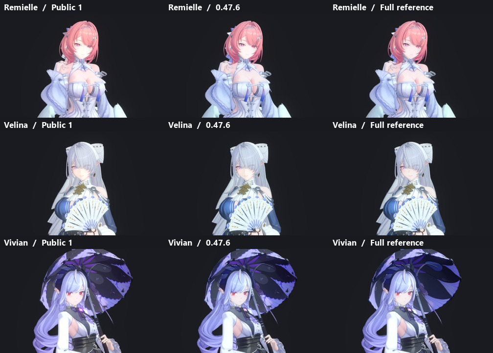
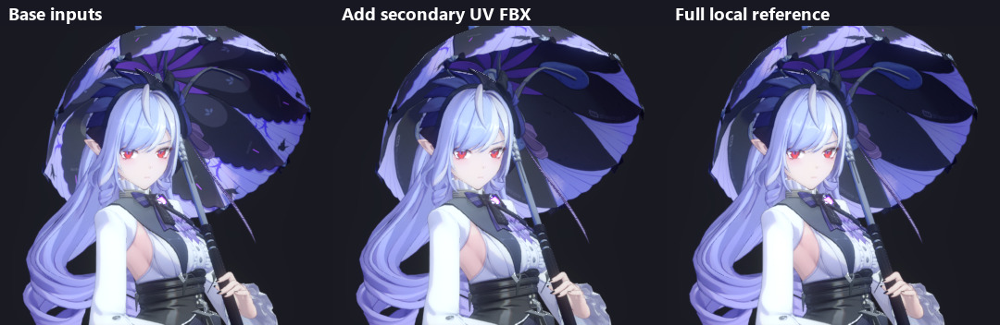

# What changes between base inputs and the gallery?

[简体中文](inputs.zh-CN.md) · [User guide](../README.md) · [Shader walkthrough](shading.en.md)

The capture gallery uses the full local reference configuration. A character FBX, its base textures and an idle clip are sufficient to build both cameras. Most remaining differences come from mesh channels lost on export, character grading and page artwork. Selecting an outfit already applies its material groups, body and hair light directions, environment constants, head binding, camera stops, page motion and Bloom settings.

## Generated from local inputs

| Input | What 0.47.6 does |
| --- | --- |
| Character grade | All three local reference LUT files have the same SHA-256. A shared curve with 30 independently fitted scalar coefficients generates a 32³ grade locally. The opaque and applicable translucent branches use the same transform. A supplied LUT takes precedence. The fit applies to these wardrobe presets. |
| Texture sampling | Existing biased mip selection remains active. Without authored atlases the add-on downsamples the supplied images in linear space, generating 12 chains for Remielle, 12 for Velina and 8 for Vivian. Hand-authored lower levels still require the original atlas. |
| Normals and highlights | The verified FBXs retain authored normals, tangents and topology. The loader checks tangent handedness before passing the directions to the skinning shader. Remielle's second body mesh also provides its packed outline coordinates and back-face UV. Velina's second body mesh and both weapon meshes provide the animated tangent basis. |
| Face and occlusion | Remielle and Velina retain high-precision hair-shadow caster weights in their FBX red channel. Applying the projection also requires a matching face receiver. Velina's primary FBX already carries the verified eye lookup bytes. With the matching secondary UV FBX the add-on builds her face flags, alpha and directional UV, enabling the receiver. |
| Background | Empty slots generate original lettering and a vignette. The three rows follow the preset crop, speed and phase. Supply individual page layers or one complete tiled image. The original lettering requires the corresponding local art. |

An original mesh JSON supplied locally can serve more than one input. The add-on can use it for matching surface streams and read its back-face coordinates for a two-sided material missing that UV. An explicitly supplied matching surface source or an available correct UV has priority. FBX recovery recipes apply only to verified exports. Arrays generated from the user's model stay in the Blender user data folder under `ZZZ Outfit Previews/Derived/v1`. The release contains code, numeric presets and verification fingerprints.

## Remaining dependencies by outfit

| Outfit | Missing from the base set | Single-input-group test |
| --- | --- | --- |
| Remielle | The source geometry of body mesh one, wings and hair differs from the exported FBX. Directional face UV, some eye indices and the fine face outline also need matching inputs. | Supplying only the three original mesh JSON files reduced close-up error from **3.37 to 1.91** and full-body error from **5.49 to 1.54**. |
| Velina | The primary face FBX has only the main UV. Body mesh one still lacks verified tangent handedness, and several accessories lack packed outline directions. The fine jaw outline uses separate data. | Supplying only the secondary UV FBX restored the face data and took the errors from **2.54 to 2.32** close and **3.62 to 3.56** wide. Supplying only the exact LUT gave **1.90 / 3.16**. |
| Vivian | The parasol uses different front and back layouts. The primary FBX lacks some of the backside coordinates, the body-detail overlay and per-mesh outline directions. Body mesh two was verified to use the same primary and back-face UV. | Adding only the secondary UV reduced error from **6.48 to 1.76** close and **5.95 to 3.31** wide. It had a larger effect here than the exact LUT alone. |

## How the frames were tested

Each outfit was built from an empty project using the add-on operator in Blender 5.3.0 on Windows. Each generated project was reopened before rendering. The idle frame was 45, with the same near and far stops, lighting and compositor. The comparison uses the character before page composition at 576×324 with eight EEVEE samples. The score is mean absolute 8-bit RGB channel error over pixels where the previous base build, current base build and full reference all have alpha of at least 250/255. Lower values indicate closer agreement with the full Blender configuration on these images. See the README for the separate game capture comparisons.

| Outfit | Close, previous base → 0.47.6 | Full body, previous base → 0.47.6 |
| --- | ---: | ---: |
| Remielle | 6.35 → **3.37** | 8.29 → **5.49** |
| Velina | 4.93 → **2.54** | 7.13 → **3.62** |
| Vivian | 11.05 → **6.48** | 10.58 → **5.95** |

Each outfit was also rebuilt from an empty project with the release ZIP and all local auxiliary inputs. After reopening, the six close and full-body character renders differed from the previous full configuration by at most one 8-bit level in any RGBA channel at any pixel.

## Adapting a fourth character

Only these three outfits have implemented and validated presets. Another outfit or character needs its own adapter. Inventory its meshes, materials and draw order. Map each draw to the shader variant, packed texture channels, extra UVs, head frame and skeleton it actually uses. Configure preview lighting, facial features, translucent layers, accessory-specific branches and camera limits. Reuse existing nodes where their inputs and behavior match. Validate at close range, full body and during a turn before claiming support.
