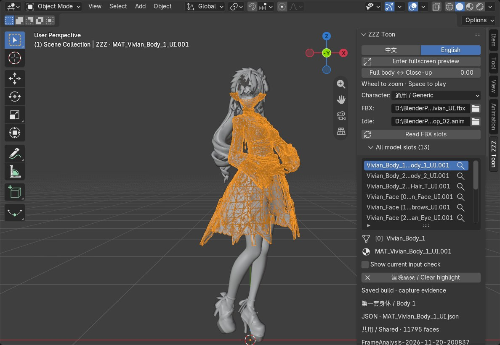
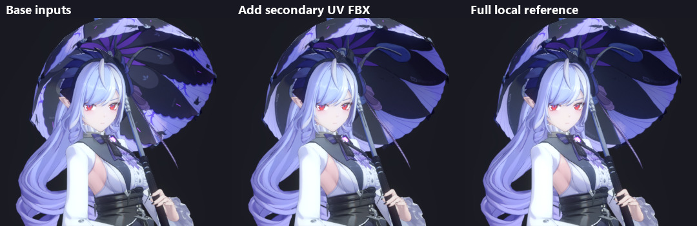

# 模型、动作和图片，分别填在哪里？

[English](inputs.en.md) · [返回安装教程](../README.zh-CN.md)

**想看角色动起来**，准备同一套服装的模型、贴图和待机动画。**只想找模型上的一个部件**，选 **通用 / Generic**，先填模型就可以。

## 先找这几种文件

| 你手里的文件 | 填在哪里 | 它管什么 |
| --- | --- | --- |
| 角色的 `.fbx` 文件 | 模型 FBX | 角色的形状，也带着驱动身体的骨架。 |
| 对应角色的 `.anim` 文件，或导出的 AnimationClip JSON | 待机动画 | 控制角色怎样站立、呼吸或摆动。插件支持 Unity 文本格式的 `.anim`。 |
| 脸、头发、衣服等部位的图片 | 对应部位的贴图格 | 决定颜色、阴影和亮光。按格子提示的文件名选图。 |
| 一张能重复拼接的背景图 | 滚动背景 | 想换背景时再填。留空会使用插件生成的背景。 |

例如，看到 `Vivian_Weapon_D.png`，就到 **Vivian → 武器与羽翼** 里找对应的底色格。这里的“武器”指她的伞。即使图片改过名，也可以手动选择你确认正确的那张。

## 「通用」里另外两个选项，什么时候填？

- **原始材质 JSON** 是游戏保存的一份外观设置表。它告诉插件这块衣料用了哪些图、阴影是什么颜色。把对应的表填到该材质一栏。插件会在模型旁边的导出目录找图；有同名图片时，可以手选。动作 JSON 要填到待机动画一栏。
- **角色抓帧文件夹** 是游戏画某一帧时留下的记录。如果你有和这套服装匹配的记录，选 `FrameAnalysis` 中直接放着绘制文件的那一层。没有抓帧也可以生成预览，插件会估计光照。普通录屏或截图没有这些绘制记录。

## 怎么看检查结果

1. 在 **通用 → 读取模型槽位 → 模型全部材质槽** 选一行。每一行对应模型的一块材质。点放大镜，看看亮起来的是衣袖、头发还是配件。用完点 **清除高亮**。
2. 补图或改了路径后，点 **检查输入文件**。如果已经打开生成的工程，先勾选 **查看当前输入检查**。修好后重新生成工程，才能看到修改后的画面。
3. 想知道这次预览实际用了什么，就看生成工程里这一行的详情。**找到文件** 表示磁盘上有这张图；**着色使用** 表示插件把它用进了这块材质。

| 面板上写着 | 用大白话说 | 接下来怎么做 |
| --- | --- | --- |
| 缺资源 | 需要的文件找不到了。 | 按提示补那一张图或那个文件。 |
| 多个候选 | 找到了几份同名文件。 | 手选这套服装用的那份。 |
| 交集外 | 这个部件或效果超出了四人共用的画法。 | 可以点放大镜看位置。想看三名预设角色的完整服装时，直接选角色名。 |
| 本次绘制已启用 | 游戏画这一部分时打开了这个效果。 | 可以对照原画面看它影响了哪里。 |
| 本次绘制未生效 | 在这次记录里，开关关着，或输入的值让效果没有起作用。 | 单凭这条提示无需补图。 |
| 该槽没有已核实的绘制证据 | 这一帧无法确认这块材质有没有用到该效果。 | 需要确认时，检查是否给了同一套服装的抓帧。 |

**举个例子。** 游戏画一帧时，会分多次画身体、脸和饰品，每一次都有编号。Remielle 的脸在第 44 和 57 次绘制里，腮红输入都是零，所以这两次都没有加上腮红。Vivian 的身体在第 37 次绘制里打开了额外叠色。这个结论只适用于记录中的那次绘制。

## 基本图都填了，为什么还有地方不对？

有些部位需要第二套 **UV**。UV 告诉 Blender 图片的哪一块该贴到模型的哪一面。看下面 Vivian 的伞内侧：左图只填基本文件，中图加上了同一模型的辅助 UV，右图用了完整参考文件。

| 看见的问题 | 先查什么 |
| --- | --- |
| Vivian 的伞内侧图案不对 | 先查武器贴图，再看是否有同源的辅助 UV 模型。 |
| Velina 脸上的阴影形状不对 | 先查脸部光照图，再查脸部的辅助 UV。 |
| Remielle 羽翼的外轮廓不对 | 检查是否用了对应服装的模型。手边有配套的原始网格文件时，再填相应的辅助格。 |
| 角色无法播放待机 | 检查动画是否属于这套模型，以及骨骼名称和路径是否匹配。 |
