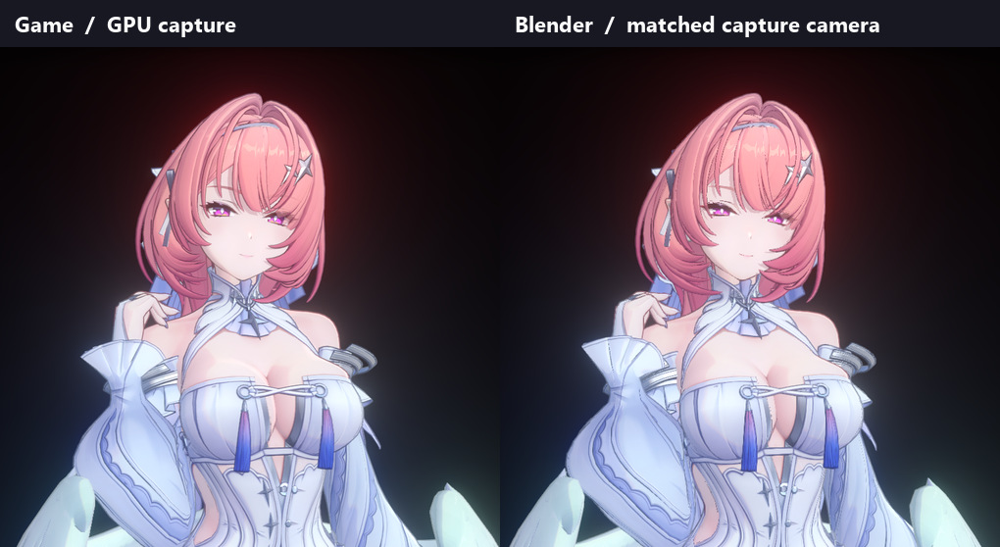

# How does a white sleeve get its game look?

[简体中文](shading.zh-CN.md) · [Project overview](../README.md) · [Set up your first preview](quickstart.en.md) · [Which file goes where?](inputs.en.md)

Look at Remielle’s cuff. The cloth is white, but there is a blue-gray shadow in the folds. A silver ring nearby catches a much brighter strip of light. A **shader** is the set of rules Blender uses to pick the color of each spot. The add-on sets up these rules for you when you build a preview.

## Start with the cloth

1. **Give it a color.** The base color image supplies the white cloth and any pattern on it. The model’s UVs tell Blender which patch of the picture belongs on the cuff.
2. **Decide where it gets dark.** Think of shining a light on a folded sheet of paper. One side faces the light. The other faces away. The shader checks which way the light shines, which way the cloth faces, and where the image says to place the shadow. This gives the fold a clear shadow edge.
3. **Add shine where it belongs.** The cloth and the silver ring can be on the same image. A second image marks which part is cloth and which part is metal. The shader can put a bright spot on the ring while keeping the cloth soft.

## What do D, N, M and A mean?

Take `Vivian_Body_1_D.png`. The **D** at the end tells you this is the base color image for that outfit part. Its other images do different jobs. An image can store red, green, blue and alpha. Each is a **channel**. Alpha often tells you how see-through a part is. The A in a file name stands for a whole extra image with channels of its own.

| File or box | What it does |
| --- | --- |
| **D · Base color** | Supplies the color and pattern of the clothes, hair or skin. |
| **N · Normal and lighting** | On the body and hair, red and green tell the shader which way a tiny patch faces. This lets folds catch the light. Blue can move the edge of the shadow. |
| **M · Material mask** | Red marks groups of parts. Each group can use its own shadow or outline color. Green affects the metal look. Blue marks where an ordinary highlight can appear. |
| **A · Auxiliary channels** | The job depends on the part. For example, the tested sheer cloth uses red to control how much background shows through. Some metals use blue to limit reflections. |
| **Face lightmap** | Guides the edge of the shadow on the face. The game can give this box the same name as the N input on the body. Pick the face lightmap for the face. |
| **Eye color lookup** | A tiny color chart. Parts of the eye have numbers on the model. The shader uses those numbers to pick colors from the chart. |
| **MatCap · Reflection image** | A picture with light and dark areas already painted in. The shader picks a spot on it based on which way the surface faces and where you are looking from. This adds shine to metal or gems. |

If you connect images yourself in Blender’s **Shader Editor**, use **sRGB** for base color. Choose **Non-Color** for N, M, A, the face lightmap and the eye chart so Blender reads their numbers as stored. The add-on handles this when you pick the files in its panel.

## Why do the face, eyes and hair need their own rules?

- **Face.** When the head turns, the shadow on the cheek should follow the head and the light. With matching inputs, the shader can also work out where the fringe casts a shadow on the face.
- **Eyes, brows and lashes.** The eyes use a base color and the eye chart. The brows and lashes have their own shapes. The preview then works out how much of each you can see through the fringe. If Velina’s fringe hides an eye, check the extra hair image marked A. If only the eye color is wrong, start with the eye chart.
- **Hair.** Several locks of hair can share a bright band. The game can use a different light direction for hair and body. The shape of the head also helps place that band.
- **Accessories and edges.** The front and back of a parasol may each have their own UVs, so each side can show a different pattern. An **outline** is the thin line around a shape. A **rim light** is the bright area near the edge when it catches the light.

## How does it all become one picture?

The add-on works out the colors of the parts, then how the hair, eyes and sheer cloth overlap. A very bright spot can spread a little light around itself. This glow is called **Bloom**. The character and glow go over the scrolling background.

A tiny pattern can flicker as you zoom out. The shader picks from smaller copies of the image as the pattern gets smaller on screen. If you have the game’s set of image sizes, you can supply it under **Mip atlases**. The **Character color LUT** has a different job. It works like a chart that says, “For this input color, use this output color.”

**Compare one thing at a time.** If the cuff’s shadow is in the wrong place, stop the character and camera at the same angle. Check the N image and the direction of the light first. If the cloth looks right but the ring is dull, check the M image and MatCap.
