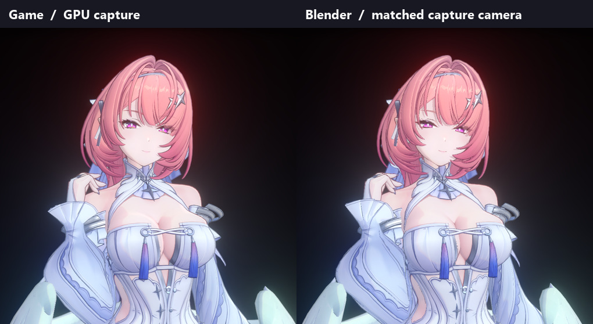

# 一件白衣服，怎么画出绝区零里的样子？

[English](shading.en.md) · [返回首页](../README.zh-CN.md) · [文件填在哪一格](inputs.zh-CN.md)

先看 Remielle 的袖口。它是白布，但褶皱处有一片偏蓝的阴影，旁边的银环又有一道很亮的反光。**着色器（shader）** 就是 Blender 用来决定“这一点该画成什么颜色”的一套规则。插件已经把这些规则接好了，只看角色可以直接用预设。

## 先看白布：底色、阴影、亮光

1. **先给布上色。** 底色图提供白布的颜色，也能画上花纹。模型上的 UV 告诉 Blender，图上的袖口该贴到哪一片布上。
2. **再决定哪里变暗。** 想象你拿手电照一张折过的白纸。朝着光的一面更亮，背着光的一面更暗。插件会同时看光从哪来、衣服表面朝哪边，以及贴图给的阴影范围。这样袖子能画出一块清楚的阴影。
3. **给不同材料加不同的亮光。** 白布和银环可以画在同一张图里。另一张图会标出哪块是布、哪块是金属。插件再按各自的设置，给银环加亮斑，让旁边的布保留柔和的颜色。

## 文件名后面的 D、N、M、A 是什么？

拿 `Vivian_Body_1_D.png` 举例，末尾的 **D** 是这组衣服的底色图。同一部位的其他图片分工不同。一张图可以分别存红、绿、蓝和透明度四份数值，每一份叫一个**通道**。游戏用这些数值标记不同区域。文件名末尾的 A 代表一整张辅助图，这张图也有自己的通道。

| 文件或面板名字 | 它负责什么 |
| --- | --- |
| **D · 底色** | 衣服、头发和皮肤本来的颜色与花纹。 |
| **N · 法线与光照** | 在身体和头发上，红、绿通道告诉插件小块表面朝哪边，让褶皱能接到光。蓝通道还能挪动明暗交界。 |
| **M · 材质遮罩** | 红通道给区域分组。不同组可以用不同的阴影色和描边色。绿通道影响金属感，蓝通道标出普通亮斑能出现在哪里。 |
| **A · 辅助通道** | 它的用途要看部位。例如，已验证的薄布用红通道控制能透出多少背景；部分金属用蓝通道限制反光区域。 |
| **脸部光照图** | 脸单独用一张图安排明暗交界。虽然它和身体的 N 图可能用同一个输入名字，脸上这一格要填脸部光照图。 |
| **眼睛查色表** | 一张很小的颜色表。模型给眼睛的不同位置标了编号，插件照编号去图里取颜色。 |
| **MatCap · 反光图** | 图里已经画好了亮区和暗区。插件根据表面朝向和观看角度从图上取颜色，能给银饰、宝石等部位加上反光。 |

如果自己在 Blender 的**着色器编辑器**里接贴图，底色图用 **sRGB**。N、M、A、脸部光照图和眼睛查色表里的数值要原样读取，选 **Non-Color（非彩色）**。通过插件选图时，这些设置由插件处理。

## 为什么脸、眼睛和头发要分开画？

- **脸。** 转动头部，脸颊上的阴影应当随着头和光的方向变化。有匹配数据时，插件还会计算刘海在脸上投下的影子。
- **眼睛和眉睫。** 眼睛用底色和查色表，眉毛、睫毛也有各自的形状。最后还要算刘海挡住它们多少。若 Velina 的眼睛被挡住，先查刘海的辅助图；若只有眼睛颜色错了，就先查眼睛查色表。
- **头发。** 一束束头发连在一起，能形成一整条高光带。游戏画头发时可以使用与身体不同的光向，还会参考头部的形状来安排这条亮带。
- **配件和边线。** 伞面的正反两面可能各用一套 UV，所以同一张图能在两面显示出不同的花纹。轮廓上的细线是**描边**；轮廓附近受光后发亮的一圈是**边缘光**。排查时要分开看。

## 最后，怎样得到预览画面？

插件先算角色各部位的颜色，再处理头发、眼睛和薄布的遮挡。很亮的部分还可以向周围散出一点光晕，这叫 **Bloom**。角色和光晕最后一起放到滚动背景上。

近看花纹清楚，拉远后细线容易闪。为此，插件会按画面里花纹的大小，选用同一张图的不同清晰度。手边有游戏原本那组大小图时，可填入 **采样图集**。**角色调色 LUT** 则管整套颜色怎样变化，可以把它理解成一张“输入这个颜色，就换成那个颜色”的表。

**自己对照时，一次只看一个问题。** 例如袖口阴影位置不对，就让角色和相机都停在同一角度，先查 N 图和光向。若衣服颜色对、银环却不亮，就查 M 图和 MatCap。这样更容易找对要改的那一项。
